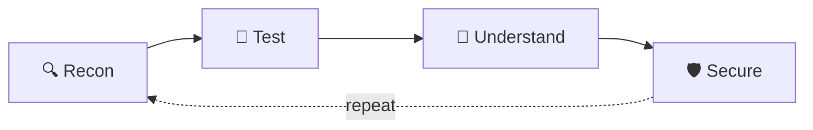

<!-- ============================ HEADER ============================ -->
<div align="center">


<a href="https://github.com/ethicalninja1">
  
</a>

<br/><br/>


<br/><br/>

<a href="https://www.instagram.com/ethicalninja01"></a>
<a href="mailto:Indar1@proton.me"></a>
<a href="https://github.com/ethicalninja1"></a>

</div>

<br/>


## 👨‍💻 About Me

<table>
<tr>
<td width="60%" valign="top">

```python
class EthicalNinja:
    alias    = "INDAR 🥷"
    role     = "Cybersecurity Enthusiast | Ethical Hacker"
    focus    = ["Web Security", "Network Security",
                "OSINT", "Security Automation"]
    daily_os = "Kali Linux 🐧"
    mindset  = "Understand → Test → Learn → Secure 🔐"
    contact  = "Indar1@proton.me 📫"

    def motto(self):
        return "Break it to understand it. Understand it to secure it."
```

</td>
<td width="40%" valign="top">

- 🔭 Exploring **pentesting, recon & automation**
- 🛠️ Building **open-source security tools**
- 📚 Studying **OWASP, networking & Linux internals**
- 🤝 Open to **collabs, CTFs & research**
- ⚖️ Always **authorized & ethical**

</td>
</tr>
</table>


## ⚔️ Tech Arsenal

<div align="center">


<br/><br/>


</div>

<br/>

| Category | Tools / Skills |
|:--|:--|
| 🐧 **Operating Systems** | Kali Linux • Linux |
| 🔎 **Recon & OSINT** | Nmap • WHOIS • DNS Tools • OSINT Framework |
| 🌐 **Web Security** | Burp Suite • OWASP Top 10 |
| 🦈 **Network Analysis** | Wireshark |
| 💥 **Security Testing** | Metasploit |
| ⚙️ **Automation** | Python • Bash |
| 🛠️ **Version Control** | Git • GitHub |


## 🚀 Featured Projects

<table>
<tr>
<td width="50%" valign="top">

### 🔑 [IndarGen](https://github.com/ethicalninja1/indargen)
OSINT-driven smart wordlist generator for **authorized** penetration testers. Builds targeted lists instead of generic ones.


</td>
<td width="50%" valign="top">

### 🧪 [UnzipVirus Pro](https://github.com/ethicalninja1/unzipVirus-)
Archive-parsing resilience testing utility for **authorized** assessments and defensive validation.


</td>
</tr>
<tr>
<td width="50%" valign="top">

### 🛰️ [ReconX](https://github.com/ethicalninja1/ReconX)
Reconnaissance toolkit for information gathering and attack-surface mapping.


</td>
<td width="50%" valign="top">

### 🗺️ [Cyber Roadmap](https://github.com/ethicalninja1/Cyber-Roadmap-)
A structured, step-by-step learning roadmap for anyone starting in cybersecurity.


</td>
</tr>
</table>


## 🧩 My Workflow

<div align="center">




</div>


## 📊 GitHub Stats

<div align="center">


<br/>


<br/>


</div>


## 🏆 Trophies

<div align="center">


</div>

## 🐍 Contribution Snake

<div align="center">


</div>


## 🎯 Current Focus

```text
🔐 Cybersecurity        ████████████████████░░  90%
🥷 Ethical Hacking      ██████████████████░░░░  80%
🔎 OSINT                █████████████████░░░░░  75%
🌐 Web Security         ████████████████░░░░░░  70%
⚡ Automation (Python)  ███████████████░░░░░░░  65%
```

## 🗺️ 2026 Goals

- [x] 🐧 Set up Kali Linux lab
- [x] 🛠️ Publish first security tools on GitHub
- [ ] 🌐 Master OWASP Top 10
- [ ] 🏁 Play CTFs regularly (TryHackMe / Hack The Box)
- [ ] 📝 Write security blogs & write-ups
- [ ] 🎓 Earn a recognized cybersecurity certification


## 📫 Let's Connect

<div align="center">

| Platform | Link |
|:--:|:--:|
| 📸 **Instagram** | [@ethicalninja01](https://www.instagram.com/ethicalninja01) |
| 📧 **Email** | [Indar1@proton.me](mailto:Indar1@proton.me) |
| 🐙 **GitHub** | [@ethicalninja1](https://github.com/ethicalninja1) |

<br/>

> *"The more you understand how systems work, the better you can protect them."* 🔐

### 🥷 `THINK • TEST • SECURE`

⚠️ *All security research is performed only on systems I own or have explicit authorization to test.*


</div>
