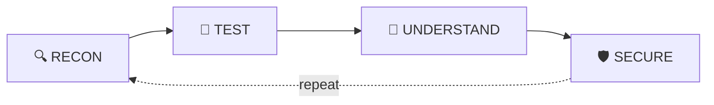

<div align="center">


<a href="https://ethiclninja1.vercel.app/">
  
</a>

<br/>

<a href="https://ethiclninja1.vercel.app/"></a>
<a href="https://www.instagram.com/ethicalninja01"></a>
<a href="mailto:Indar1@proton.me"></a>

<br/>


</div>

---

## `>_ whoami`

```bash
root@kali:~# cat about.txt

  ┌──────────────────────────────────────────────────────┐
  │  ALIAS     : INDAR  (aka Ethical Ninja 🥷)           │
  │  ROLE      : Cybersecurity Enthusiast | Ethical Hacker│
  │  OS        : Kali Linux 🐧                            │
  │  FOCUS     : Web Sec • Network Sec • OSINT • Automation│
  │  MINDSET   : Understand → Test → Learn → Secure 🔐    │
  │  WEBSITE   : https://ethiclninja1.vercel.app          │
  │  CONTACT   : Indar1@proton.me 📫                      │
  │  STATUS    : [■■■■■■■■■□] Learning & Building         │
  └──────────────────────────────────────────────────────┘

root@kali:~# █
```

- 🔭 Exploring **pentesting, recon & security automation**
- 🛠️ Building **open-source security tools** and a **free cybersecurity roadmap** for beginners
- 📚 Studying **OWASP, networking & Linux internals**
- 🤝 Open to **collabs, CTFs & research**
- ⚖️ Always **authorized & ethical**

---

## `>_ ls ./website`

<div align="center">

<a href="https://ethiclninja1.vercel.app/">
  
</a>

</div>

```text
📂 ethiclninja1.vercel.app
 ├── 🗺️  Roadmap   → 6 stages, beginner to advanced
 ├── 🎯 Practice   → TryHackMe • Hack The Box • PicoCTF • PortSwigger
 ├── 💼 Careers    → Pentester • SOC • Bug Bounty • Red Team
 ├── ❓ FAQ        → Common questions for beginners
 └── 📡 Community  → Free • Structured • Beginner to Advanced
```

---

## `>_ cat ./arsenal`

<div align="center">


<br/><br/>


</div>

| 🧰 Category | ⚙️ Tools / Skills |
|:--|:--|
| 🐧 **Operating Systems** | Kali Linux • Linux |
| 🔎 **Recon & OSINT** | Nmap • WHOIS • DNS Tools • OSINT Framework |
| 🌐 **Web Security** | Burp Suite • OWASP Top 10 |
| 🦈 **Network Analysis** | Wireshark |
| 💥 **Security Testing** | Metasploit |
| ⚡ **Automation** | Python • Bash |
| 🛠️ **Version Control** | Git • GitHub |

---

## `>_ git log --projects`

### 🔑 [IndarGen](https://github.com/ethicalninja1/indargen)
OSINT-driven smart wordlist generator for **authorized** penetration testers. Builds targeted lists instead of generic ones. `Python` `OSINT` `Pentesting`

### 🧪 [UnzipVirus Pro](https://github.com/ethicalninja1/unzipVirus-)
Archive-parsing resilience testing utility for **authorized** assessments and defensive validation. `Python` `Security Testing`

### 🛰️ [ReconX](https://github.com/ethicalninja1/ReconX)
Reconnaissance toolkit for information gathering and attack-surface mapping. `Recon` `Automation`

### 🗺️ [Cyber Roadmap](https://github.com/ethicalninja1/Cyber-Roadmap-)
Structured, step-by-step learning roadmap for anyone starting in cybersecurity. Live at **[ethiclninja1.vercel.app](https://ethiclninja1.vercel.app/)**. `HTML` `Roadmap`

---

## `>_ ./workflow.sh`

<div align="center">



</div>

---

## `>_ ./stats --live`

<div align="center">


<br/>


<br/>


</div>

---

## `>_ ./snake.sh`

<div align="center">


</div>

---

## `>_ tail -f ./focus.log`

```text
[+] Cybersecurity        ████████████████████░░  90%
[+] Ethical Hacking      ██████████████████░░░░  80%
[+] OSINT                █████████████████░░░░░  75%
[+] Web Security         ████████████████░░░░░░  70%
[+] Automation (Python)  ███████████████░░░░░░░  65%
```

### 🎯 2026 Goals

- [x] 🐧 Set up Kali Linux lab
- [x] 🛠️ Publish first security tools on GitHub
- [x] 🌐 Launch the Cyber Roadmap website
- [ ] 🏁 Play CTFs regularly (TryHackMe / Hack The Box)
- [ ] 🎓 Master OWASP Top 10
- [ ] 📝 Write security blogs & write-ups

---

## `>_ ./contact --all`

<div align="center">

| 📡 Channel | 🔗 Link |
|:--:|:--:|
| 🌐 **Website** | [ethiclninja1.vercel.app](https://ethiclninja1.vercel.app/) |
| 📸 **Instagram** | [@ethicalninja01](https://www.instagram.com/ethicalninja01) |
| 📧 **Email** | [Indar1@proton.me](mailto:Indar1@proton.me) |
| 🐙 **GitHub** | [@ethicalninja1](https://github.com/ethicalninja1) |

<br/>

```bash
root@kali:~# echo "Hack ethically. Stay legal. Stay curious."
```

### 🥷 `THINK • TEST • SECURE`

⚠️ *All security research is performed only on systems I own or have explicit authorization to test.*


</div>
